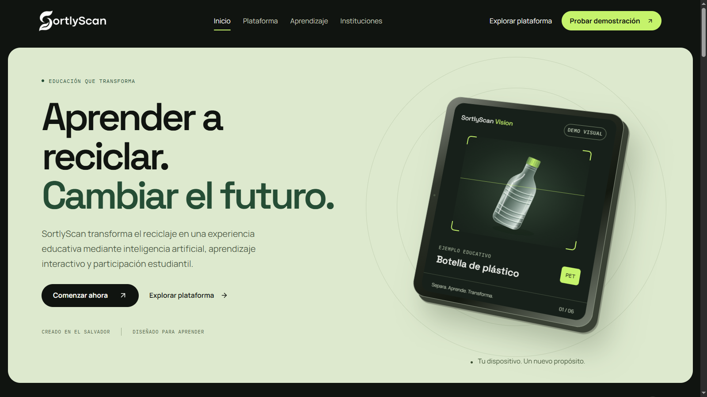
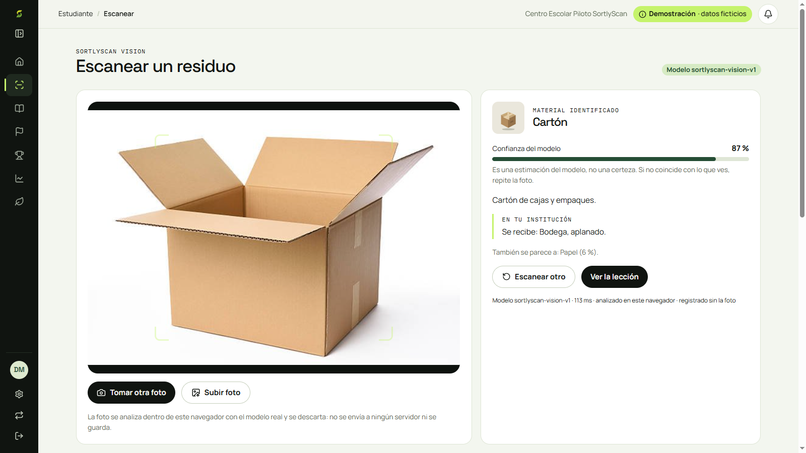
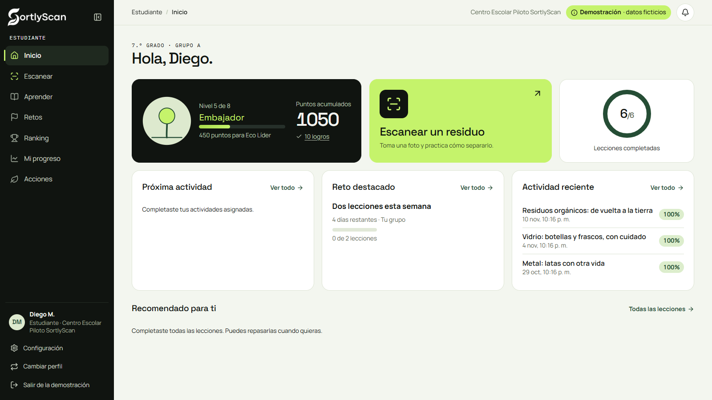
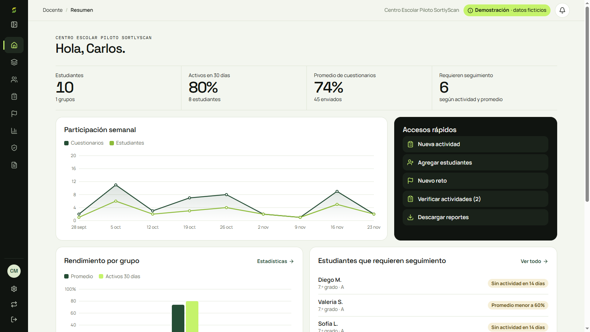
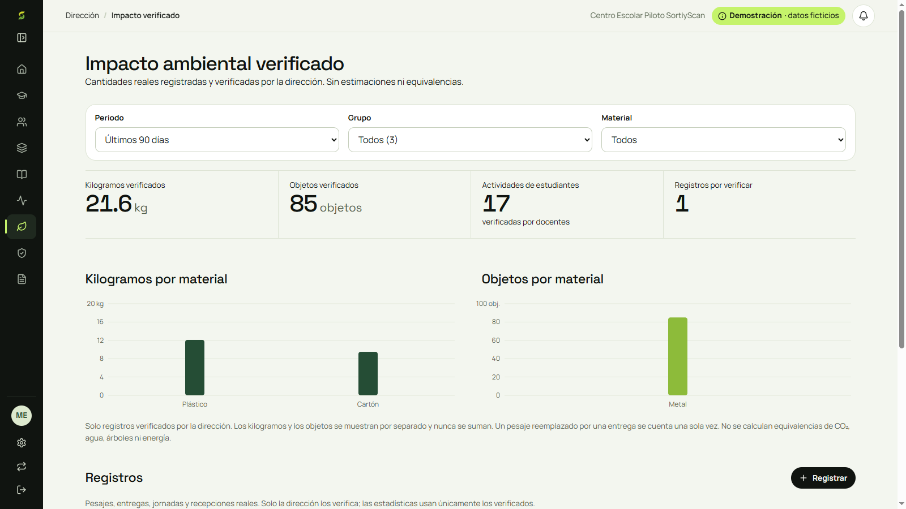

# SortlyScan

**♻🤖 Artificial Intelligence, Environmental Education & Sustainability**

An AI-powered educational platform designed to promote recycling, environmental awareness, and sustainable practices through computer vision, interactive learning, gamification, and institutional management.

---

## About the Project

SortlyScan is an educational technology project developed in El Salvador to promote environmental responsibility and improve waste classification practices within educational institutions.

The platform combines artificial intelligence, interactive educational content, gamification, and data visualization to transform recycling into an engaging learning experience.

SortlyScan provides different experiences for students, teachers, and institutional administrators, creating a collaborative environment for environmental education.

The current version is an interactive demonstration that uses fictional institutional data to showcase the platform's capabilities.

## Project Goals

- Promote environmental awareness and responsible recycling.
- Apply artificial intelligence to waste classification.
- Encourage student participation through gamification.
- Provide accessible and interactive environmental education.
- Support teachers in monitoring student learning.
- Provide institutions with environmental performance indicators.
- Encourage sustainable practices through technology.

## Technologies Used

| Technology | Purpose |
|---|---|
| Next.js | Application framework |
| React | Interactive user interfaces |
| TypeScript | Application development |
| HTML5 & CSS3 | Interface structure and styling |
| ONNX | Machine learning model format |
| ONNX Runtime Web | Browser-based AI inference |
| Computer Vision | Image classification |
| Node.js | Development environment |
| GitHub Actions | Automated deployment |
| GitHub Pages | Static website hosting |

## Features

### SortlyScan Vision

- AI-powered waste image classification.
- Camera and image upload support.
- Browser-based AI inference.
- Prediction confidence indicators.
- Material identification and recycling guidance.
- Integration with related educational lessons.
- Local image processing.

### Student Experience

- Interactive environmental lessons.
- Educational quizzes.
- Points and achievement systems.
- Progress tracking.
- Student rankings.
- Environmental challenges.
- Practical recycling activities.

### Teacher Experience

- Student and group management demonstrations.
- Learning progress monitoring.
- Educational activity management.
- Challenge creation.
- Student performance indicators.
- Activity verification and reporting.

### Institutional Management

- Institutional performance dashboard.
- Environmental impact monitoring.
- Waste collection records.
- Material classification statistics.
- Activity verification.
- Institutional reporting and analytics.

## How It Works

### 01. Waste Classification

Users capture or upload an image of a waste item. The image is processed locally in the browser using the SortlyScan Vision model.

The application displays the predicted material, its confidence score, and relevant recycling guidance.

### 02. Interactive Learning

Students access educational lessons, quizzes, and environmental challenges to develop responsible recycling habits.

The gamification system encourages participation through points, levels, achievements, and progress tracking.

### 03. Educational Management

Teachers can explore student performance, organize activities, monitor participation, and review educational progress.

### 04. Environmental Analytics

Institutional administrators can explore environmental indicators, waste collection records, and material statistics.

The demonstration distinguishes between kilograms and individual objects, avoiding unsupported environmental impact estimates.

## Development Process

### Phase 01 — Research and Problem Identification

Analysis of environmental education challenges, recycling practices, and opportunities for technological innovation.

### Phase 02 — Concept and Brand Development

Definition of the platform's value proposition, visual identity, educational approach, and user experience.

### Phase 03 — Artificial Intelligence Integration

Integration of an ONNX image classification model for browser-based waste recognition.

### Phase 04 — Platform Development

Development of student, teacher, and institutional interfaces, including interactive learning, gamification, and analytical dashboards.

### Phase 05 — Interactive Demonstration

Independent redesign and development of the platform into an interactive demonstration using fictional institutional data.

### Phase 06 — Code Organization

Improvement of code readability, project organization, interface consistency, and maintainability.

## Running the Project

### Requirements

- Node.js 22 or later
- npm
- Modern web browser

### Clone the Repository

```bash
git clone https://github.com/waltdev16/SortlyScan_ExpoTech.git
```

### Navigate to the Project

```bash
cd SortlyScan_ExpoTech
```

### Install Dependencies

```bash
npm install
```

### Start the Development Server

```bash
npm run dev
```

### Type Checking

```bash
npm run typecheck
```

### Production Build

```bash
npm run build:static
```

## Project Structure

```text
SortlyScan_ExpoTech/
├── .github/
│   └── workflows/
├── frontend/
│   ├── public/
│   ├── scripts/
│   ├── src/
│   │   ├── app/
│   │   ├── components/
│   │   ├── data/
│   │   └── lib/
│   ├── next.config.ts
│   └── package.json
├── docs/
│   └── images/
├── scripts/
├── tests/
├── .gitignore
├── package.json
├── package-lock.json
└── README.md
```

## Preview

### Landing Page



### Artificial Intelligence Scanner



### Student Dashboard



### Teacher Dashboard



### Environmental Impact



## Project Scope

The current release is an interactive educational demonstration.

- Institutional records and user profiles are fictional.
- The AI scanner performs browser-based image classification.
- Classification results represent model predictions rather than guaranteed identifications.
- Production authentication and institutional database services are outside the scope of this demonstration.

## Future Improvements

- Production authentication and authorization.
- Persistent institutional databases.
- Expanded waste classification capabilities.
- Additional educational content.
- Improved accessibility.
- Institutional pilot testing.
- Advanced environmental analytics.
- Mobile application development.

## Authors

### Original Project — ExpoTech

- Walter Santos
- Daniel Amaya
- Emily Calzada
- Fabio Molina
- Samuel Aguirre
- Pamela Ortiz
- Abdul Rivera
- Christopher Amaya
- Fatima Mendez 
- Hugo Cantor
- Katherine Alvarado
- Andy Pineda
- Andrea Mejia
- Joel Alvarado

### Redesign & Development — Version 2.0 (2026)

- Walter Santos

The current interactive version was independently redesigned and developed by Walter Santos, building upon the original SortlyScan team project.

---

**Centro ¡Supérate! Fundación Frech**
